# VYOM+ — Intelligent Voucher Classification Using Open-Source LLMs

> **Hacktober Fest | Elevate Open Source AI Hackathon**
>
> **Selected Problem Statement:** VYOM+ — Intelligent Voucher Classification Using Open-Source LLMs

## 1. Executive Summary

Businesses receive large volumes of structured transaction records containing fields such as supplier/customer, invoice details, item descriptions, quantities, taxable values, GST, payment information, order references, delivery information, returns, payroll information, and other metadata. The accounting action that should be performed — represented by a **voucher category** — is often not directly available in the incoming record.

This project proposes an **AI-first, end-to-end voucher classification system** that reads the structured Excel transaction dataset supplied for the challenge and predicts the appropriate voucher category for every record.

The system is designed around a hybrid architecture:


The central design principle is:

> **Do not classify a transaction from a single keyword. Understand the entire transaction context, generate plausible voucher candidates, reason over the evidence with an open-weight LLM, constrain the result to a valid schema, and expose confidence plus an explanation.**

The challenge statement explicitly requires the system to reason over multiple transaction fields, use an open-source/openly available LLM/SLM or suitable AI architecture as the primary intelligence layer, handle incomplete or ambiguous information, and produce structured output that can be evaluated on unseen records. It also notes that evaluation may consider accuracy, precision, recall, F1-score, per-category performance, ambiguity handling, consistency, inference speed, and computational efficiency.

This README therefore treats **generalization, per-class performance, ambiguity handling, reproducibility, and structured outputs** as first-class engineering requirements rather than optional features.

---

## 2. Problem Understanding

### 2.1 What the challenge provides

The challenge provides an Excel dataset in which:

- each row represents a transaction/document;
- relevant transaction fields are already structured;
- the **voucher-type column is intentionally missing**;
- the model must infer exactly one appropriate voucher category;
- evaluation may use a hidden dataset containing ground-truth voucher types.

The organizer-defined possible inputs include:

- Seller / supplier
- Buyer / customer
- Invoice number and date
- Item descriptions
- Quantities
- Taxable value
- GST
- Discounts
- Freight
- Payment information
- Currency
- Import/export information
- Payroll information
- Debit/credit information
- Return information
- Order references
- Delivery information
- Other metadata

### 2.2 Target label space

The challenge defines the following voucher categories:

1. Purchase
2. Sales
3. Purchase Return / Debit Note
4. Sales Return / Credit Note
5. Payment
6. Receipt
7. Contra
8. Journal
9. Salary / Payroll
10. Attendance
11. Purchase Order
12. Sales Order
13. Receipt Note
14. Delivery Note
15. Rejection In
16. Rejection Out
17. Stock Journal
18. Physical Stock
19. Material In
20. Material Out
21. Job Work In Order
22. Job Work Out Order
23. Import
24. Export
25. Expense
26. Advance / Prepayment
27. Other / Miscellaneous

That is a **27-class multiclass classification problem**.

A purely uniform random classifier would have an exact-match accuracy of:

\[
1/27 \approx 3.70\%
\]

However, this is only a mathematical reference point. The actual class distribution is not provided in the problem statement, so a real majority-class baseline cannot be calculated until the dataset is received.

### 2.3 Why this is not ordinary text classification

The same words can appear in multiple voucher types.

For example:

- "Invoice" can occur in both purchase and sales transactions.
- "Payment" can be associated with a purchase, an expense, an advance, or a settlement.
- "Return" alone does not establish whether the return is from a customer or to a supplier.
- "Bank" does not automatically mean Payment or Receipt.
- "Stock" does not automatically mean Purchase or Sales.
- "Order" does not mean the transaction is necessarily a Purchase Order or Sales Order.

The important signal is therefore often the **relationship between fields** rather than the presence of an isolated term.

This matches the core technical challenge in the problem statement: distinguishing semantically similar categories through the complete transaction context.

---

# 3. Motivation and Real-World Relevance

Accounting software already treats vouchers as structured representations of different transaction events. TallyPrime's current documentation describes voucher types as records used for different business transactions and notes that voucher classes can be used to automate recurring entries and reduce manual errors.

TallyPrime also documents distinct treatment for payments, receipts, contra transactions, sales, purchase-related transactions, orders, delivery/receipt notes, and stock-oriented workflows.

This distinction is important for our system:

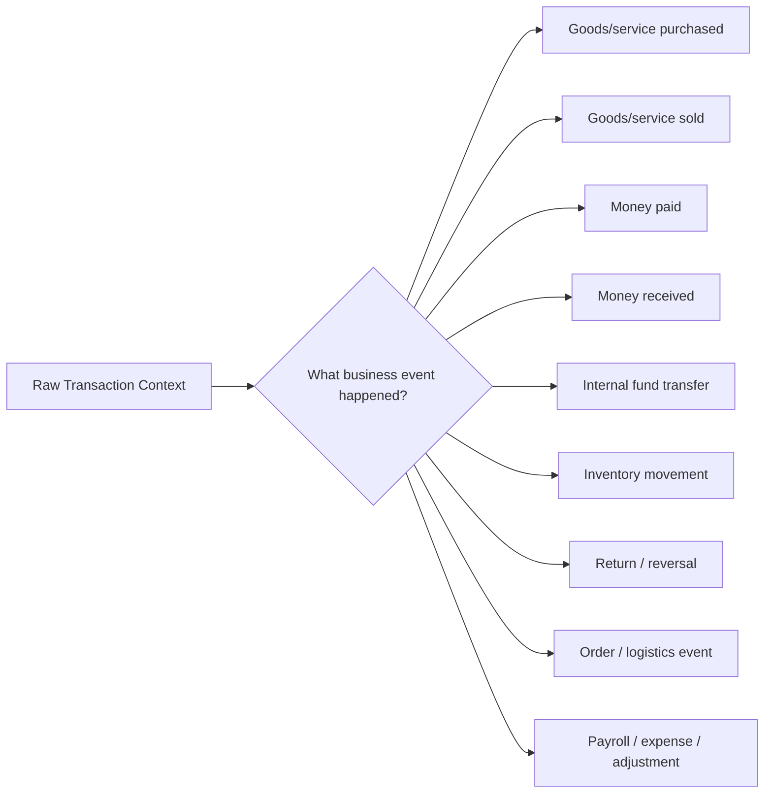

The objective is not to replace accounting rules with a generic chatbot. It is to build a **structured transaction understanding layer** that can bridge incoming business data to downstream voucher creation.

---

# 4. Proposed Solution

## 4.1 Core idea

We propose **VYOM-VoucherAI**, a hybrid classification pipeline with five intelligence layers:

1. **Data understanding layer**
   - Reads XLSX/CSV input.
   - Detects columns and data types.
   - Handles missing/null values and heterogeneous schemas.
   - Preserves original values for auditability.

2. **Accounting signal layer**
   - Derives explicit business signals from structured fields.
   - Examples: money-flow direction, stock movement, return indicators, order indicators, payment mode, import/export indicators, payroll indicators, and document references.

3. **Semantic candidate layer**
   - Converts textual fields such as item descriptions, supplier/customer names, narrations, and notes into semantic representations.
   - Uses an open embedding model such as BGE-M3 for semantic similarity and candidate retrieval.
   - Retrieves relevant voucher definitions and edge-case examples from a local voucher knowledge base.

4. **Primary reasoning layer**
   - Uses **Qwen3-8B**, an open-weight model, as the primary classification intelligence.
   - Presents the normalized transaction, derived accounting signals, and top candidate voucher definitions to the model.
   - The model reasons over the complete context rather than one field.

5. **Reliability layer**
   - Forces output into a strict JSON schema.
   - Computes/calibrates confidence.
   - Detects low-margin or internally inconsistent predictions.
   - Sends difficult records through a second reasoning pass.
   - Produces an auditable prediction record.

---

# 5. System Architecture

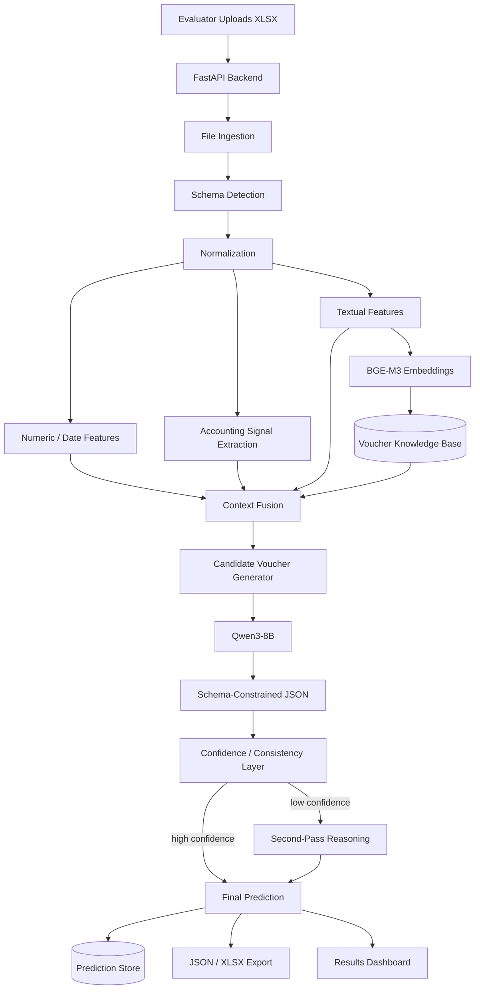

---

# 6. End-to-End Processing Workflow

## Workflow A — Dataset ingestion

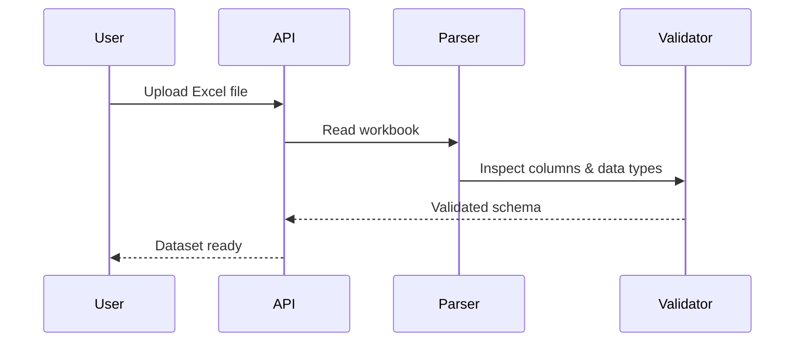

### Processing steps

1. Accept `.xlsx`.
2. Load workbook without assuming a fixed column order.
3. Detect headers using normalized names and aliases.
4. Identify numeric, date, categorical, and text fields.
5. Standardize null representations.
6. Parse numerical values and currencies.
7. Preserve the original input row ID.
8. Create an internal canonical transaction object.

Example internal representation:

```json
{
  "row_id": 1042,
  "seller_supplier": "ABC Industrial Supplies",
  "buyer_customer": "XYZ Manufacturing Pvt Ltd",
  "invoice_number": "INV-2026-1042",
  "invoice_date": "2026-09-18",
  "item_descriptions": ["Industrial bearings", "Lubricant"],
  "quantity": [10, 4],
  "taxable_value": 50000,
  "gst": 9000,
  "discount": 500,
  "freight": 750,
  "payment_information": null,
  "return_information": null,
  "order_reference": null,
  "delivery_information": "Goods received",
  "currency": "INR",
  "debit_credit_information": "Debit purchase account"
}
```

The example above is illustrative and is not taken from the organizer's dataset.

---

# 7. Feature Engineering Strategy

The system will retain both **raw fields** and **derived features**.

## 7.1 Numerical features

Examples:

- taxable value
- total invoice value
- GST amount
- discount amount
- freight
- quantity
- amount ratios
- tax-to-taxable ratio
- debit/credit totals
- payment amount

Derived consistency features can include:

\[
GST\ Ratio = \frac{GST}{Taxable\ Value+\epsilon}
\]

\[
Total\ Approximation = Taxable\ Value + GST + Freight - Discount
\]

These are supporting signals only. They do not independently determine a voucher type.

## 7.2 Temporal features

Extract:

- invoice date
- order date
- delivery date
- payment date
- return date
- relative date ordering

Example:

```text
Order → Delivery → Invoice → Payment
```

can carry significantly different meaning from:

```text
Invoice → Return → Refund
```

## 7.3 Entity-role features

Instead of treating "seller" and "buyer" as arbitrary text fields, the system explicitly models their roles:

```text
SELLER / SUPPLIER
       ↓
provides goods/services
       ↓
BUYER / CUSTOMER
```

This role relationship helps distinguish:

- Purchase
- Sales
- Purchase Return
- Sales Return

The names themselves are not treated as evidence of the class; their **roles and relationships** are.

## 7.4 Event signals

The system derives event indicators such as:

| Signal | Example meaning |
|---|---|
| `is_payment_event` | Money has been paid |
| `is_receipt_event` | Money has been received |
| `is_internal_transfer` | Cash/bank movement between own accounts |
| `is_return_event` | Goods/value are being reversed |
| `is_order_event` | Request/order rather than completed transaction |
| `is_delivery_event` | Goods movement/delivery without ordinary sales semantics |
| `is_receipt_note` | Goods received / receipt-logistics event |
| `is_stock_event` | Inventory adjustment or movement |
| `is_payroll_event` | Salary/attendance-related information |
| `is_import_event` | Import-related transaction |
| `is_export_event` | Export-related transaction |
| `is_expense_event` | Expense transaction |
| `is_advance_event` | Advance/prepayment semantics |

The flags are **candidate-generating features**, not hard-coded final answers.

---

# 8. Semantic Representation

Transactional fields such as item descriptions and narrations contain information that lexical rules can miss.

We therefore create a semantic representation of:

- item descriptions
- narration / remarks
- supplier/customer role context
- payment description
- return description
- order/delivery descriptions
- import/export description

## Proposed embedding model: BGE-M3

BGE-M3 is an open embedding model with:

- 1024-dimensional embeddings
- up to 8192 tokens
- support for more than 100 languages
- dense, sparse, and multi-vector retrieval modes
- MIT licensing

This makes it suitable as a semantic candidate-retrieval layer for heterogeneous transaction text, while keeping the primary reasoning layer separate.

The embedding layer will not decide the final voucher type. Its job is to reduce the 27-class search space to a small set of plausible candidates.

Example:

```text
Input transaction
      ↓
BGE-M3 semantic similarity
      ↓
Top candidates
      ↓
{Purchase, Purchase Order, Receipt Note}
      ↓
Qwen3 contextual reasoning
      ↓
Purchase
```

---

# 9. Voucher Knowledge Base

A compact local knowledge base will contain a **voucher card** for each of the 27 categories.

Each card will include:

```text
Voucher name
Definition
Positive indicators
Negative indicators
Required contextual clues
Commonly confused categories
Illustrative examples
```

Example:

```yaml
voucher: Contra
definition: Internal transfer between the organisation's own cash/bank accounts.
positive_indicators:
  - cash deposited into bank
  - cash withdrawn from bank
  - transfer between own bank accounts
negative_indicators:
  - supplier payment
  - customer receipt
confusions:
  - Payment
  - Receipt
```

The knowledge base is used for **retrieval and grounding**, not for replacing the model's reasoning.

This helps the system answer the question:

> "Which voucher definitions are actually relevant to this transaction?"

before asking the LLM to make the final classification.

---

# 10. Hierarchical Classification

Classifying all 27 labels directly is possible, but a hierarchical strategy should reduce confusing comparisons.

## Level 1 — Business event family

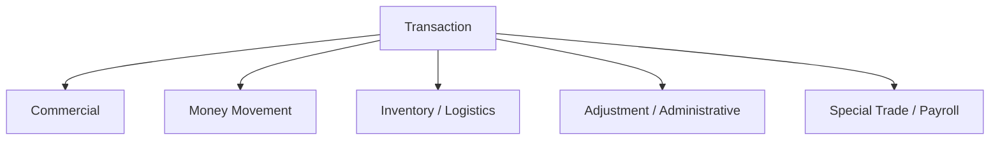

Possible grouping:

### Commercial

- Purchase
- Sales
- Purchase Return / Debit Note
- Sales Return / Credit Note
- Purchase Order
- Sales Order

### Money Movement

- Payment
- Receipt
- Contra
- Advance / Prepayment

### Inventory / Logistics

- Receipt Note
- Delivery Note
- Rejection In
- Rejection Out
- Stock Journal
- Physical Stock
- Material In
- Material Out
- Job Work In Order
- Job Work Out Order

### Adjustment / Administrative

- Journal
- Expense
- Other / Miscellaneous

### Special / Payroll / Trade

- Salary / Payroll
- Attendance
- Import
- Export

This is an **engineering taxonomy**, not a replacement for the organizer's 27 labels.

## Level 2 — Fine-grained reasoning

Once the likely event family is identified, the model compares the relevant categories.

For example:

```text
Commercial
    ├── Purchase
    ├── Purchase Order
    ├── Purchase Return / Debit Note
    ├── Sales
    ├── Sales Order
    └── Sales Return / Credit Note
```

This is particularly useful for semantically close pairs.

---

# 11. Primary AI Reasoning Layer

## Why Qwen3-8B?

We propose **Qwen3-8B** as the primary classification intelligence.

According to the official model card:

- Qwen3-8B has approximately 8.2B parameters.
- It supports a native 32,768-token context and longer-context extension using YaRN.
- It supports switching between thinking and non-thinking modes.
- It supports tool-oriented workflows.
- The model is distributed under Apache 2.0.
- It can be deployed locally through frameworks including vLLM, SGLang, llama.cpp, and Ollama.

The reasoning/non-thinking switch is particularly useful for this challenge.

### Fast path

Most records:

```text
Transaction
  ↓
Candidate set
  ↓
Qwen3 non-thinking mode
  ↓
Prediction
```

### Difficult-record path

Ambiguous records:

```text
Transaction
  ↓
Candidate set
  ↓
Qwen3 fast pass
  ↓
Low confidence / close scores / contradiction
  ↓
Qwen3 thinking mode
  ↓
Final prediction
```

This avoids spending maximum inference time on every row.

---

# 12. Why Not Use a Pure LLM Prompt?

A pure prompt such as:

```text
Classify this transaction as one of the 27 voucher types.
```

is intentionally not our final architecture.

It has several engineering weaknesses:

- no explicit schema validation;
- no systematic data normalization;
- difficult reproducibility;
- weak handling of class imbalance;
- difficult confidence estimation;
- difficult regression testing;
- possible formatting inconsistencies;
- increased risk of relying on isolated words.

Instead:

```text
Structured data
      +
Derived accounting signals
      +
Semantic candidate retrieval
      +
Voucher definitions
      +
Open-weight LLM reasoning
      ↓
Structured prediction
      ↓
Validation
      ↓
Confidence
```

This makes AI the core intelligence while surrounding it with deterministic engineering.

---

# 13. Structured Output Contract

The model will be constrained to produce a schema such as:

```json
{
  "row_id": 1042,
  "voucher_type": "Purchase",
  "confidence": 0.93,
  "alternative": "Purchase Order",
  "reason_code": "supplier_to_buyer_goods_transaction",
  "needs_review": false
}
```

For the minimum challenge requirement, the key fields are:

```json
{
  "invoice_number": "INV-2026-1042",
  "voucher_type": "Purchase"
}
```

The additional fields are proposed reliability features.

### Why structured decoding?

vLLM officially supports structured outputs including:

- JSON schema
- regex constraints
- choice constraints
- grammar constraints

This allows the inference server to constrain generation rather than relying only on prompt instructions.

The pipeline therefore becomes:

```text
LLM
 ↓
constrained decoder
 ↓
valid JSON
 ↓
schema validation
```

---

# 14. Confidence and Abstention

A classification system should not confuse **certainty of a model output** with **correctness**.

We therefore treat confidence as a separately measured property.

## Confidence signals

The proposed confidence score combines:

- classifier probability / margin
- LLM candidate preference
- agreement between deterministic signals and LLM
- semantic similarity
- contradiction detection
- second-best class distance
- calibration model

For example:

```text
Purchase           0.91
Purchase Order     0.06
Sales              0.02
Other              0.01
```

can be treated differently from:

```text
Purchase           0.38
Purchase Order     0.34
Sales              0.17
Receipt Note       0.06
Other              0.05
```

The second case should enter the **review / second-pass pipeline**.

Scikit-learn's calibration documentation notes that raw classifier probabilities may be poorly calibrated and describes cross-validation-based probability calibration methods. We will therefore evaluate calibration rather than assuming that a raw model score is a trustworthy probability.

---

# 15. Ambiguity Resolution Workflow

This is one of the most important parts of the system.

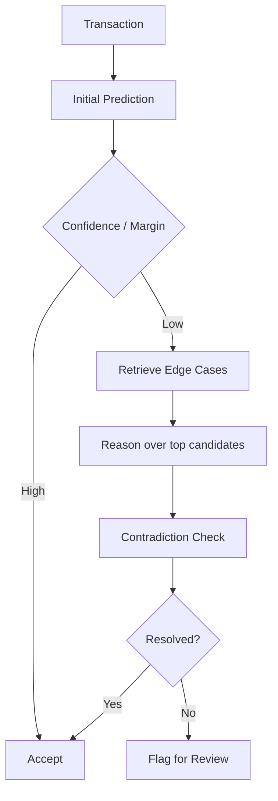

## Example: Purchase vs Purchase Order

### Transaction A

```text
Supplier: ABC Supplies
Buyer: XYZ Ltd
Item: 20 office chairs
Document reference: PO-1044
Payment: none
Delivery: pending
Narration: "Order placed"
```

Likely interpretation:

```text
Purchase Order
```

### Transaction B

```text
Supplier: ABC Supplies
Buyer: XYZ Ltd
Item: 20 office chairs
Invoice: INV-1044
Taxable value: ₹40,000
GST: ₹7,200
Delivery: received
```

Likely interpretation:

```text
Purchase
```

The distinguishing information is not simply the word "purchase". It is the **transaction stage and relationship among order, invoice, delivery and payment fields**.

---

# 16. Confusion-Pair Strategy

The system will explicitly maintain a confusion matrix and monitor high-risk pairs.

| Confusion pair | Key evidence |
|---|---|
| Purchase ↔ Purchase Order | completed transaction vs intent/order stage |
| Sales ↔ Sales Order | completed sale vs order stage |
| Purchase Return ↔ Sales Return | direction of goods/value reversal + supplier/customer role |
| Payment ↔ Receipt | direction of monetary flow |
| Payment ↔ Contra | external payment vs internal account transfer |
| Receipt ↔ Contra | external receipt vs internal transfer |
| Journal ↔ conventional transaction | adjustment/accounting entry vs ordinary transaction |
| Stock Journal ↔ Purchase/Sales | inventory movement vs commercial transaction |
| Receipt Note ↔ Purchase | goods received/logistics event vs completed purchase |
| Delivery Note ↔ Sales | goods dispatch/logistics event vs completed sale |
| Material In ↔ Receipt Note | physical/material movement semantics |
| Material Out ↔ Delivery Note | physical/material outward movement |
| Expense ↔ Payment | economic event vs settlement mechanism |
| Advance/Prepayment ↔ Payment | advance nature vs ordinary settlement |
| Import ↔ Purchase | trade classification and cross-border evidence |
| Export ↔ Sales | trade classification and cross-border evidence |

The point is to make difficult boundaries **explicit and testable**.

---

# 17. Model Training / Adaptation Plan

The architecture is designed to work in three stages.

## Stage 1 — Zero/Low-shot baseline

Before any fine-tuning:

- Qwen3-8B
- strong system prompt
- voucher definitions
- few canonical examples
- structured decoding

This establishes a reproducible baseline.

## Stage 2 — Supervised lightweight classifier

Once labeled examples are available:

- train a conventional classifier using engineered/semantic features;
- train on the provided training split;
- use stratified validation;
- use it for candidate generation and comparison.

Potential models:

- Logistic Regression on TF-IDF
- Linear SVM
- Gradient-boosted trees on structured features
- small neural classifier over embeddings

This gives the team a quantitative baseline that is fast and inexpensive.

## Stage 3 — Optional LoRA/QLoRA adaptation

If the dataset is sufficiently large and the time budget permits:

- fine-tune Qwen3-8B with LoRA/QLoRA;
- preserve the base model weights;
- train lightweight adapters;
- compare against the prompt-only baseline.

Hugging Face's PEFT documentation describes LoRA as an efficient parameter-efficient fine-tuning method that reduces the number of trainable parameters relative to full fine-tuning.

Fine-tuning will **not** be treated as mandatory. It is activated only if validation demonstrates a meaningful improvement.

---

# 18. Evaluation Methodology

The challenge statement explicitly allows evaluation against an unseen dataset and mentions accuracy, precision, recall, F1, per-category performance, ambiguity handling, output consistency, inference speed, and computational efficiency.

Our internal evaluation will therefore report more than one number.

## 18.1 Primary metrics

### Accuracy

\[
Accuracy = \frac{Correct\ Predictions}{Total\ Predictions}
\]

Useful for overall exact-match performance.

### Precision

Measures how often predictions assigned to a class are correct.

### Recall

Measures how much of a class the system successfully identifies.

### F1-score

\[
F1 = \frac{2PR}{P+R}
\]

The F1 score balances precision and recall.

### Macro-F1

Macro-F1 gives every class equal weight:

\[
MacroF1 = \frac{1}{27}\sum_{i=1}^{27}F1_i
\]

This is particularly important because a system can obtain high accuracy by performing well on common classes while failing rare classes.

Scikit-learn's classification report explicitly exposes per-class precision, recall, F1, support, macro average, and weighted average.

---

# 19. Confusion Matrix

We will maintain a 27 × 27 confusion matrix:

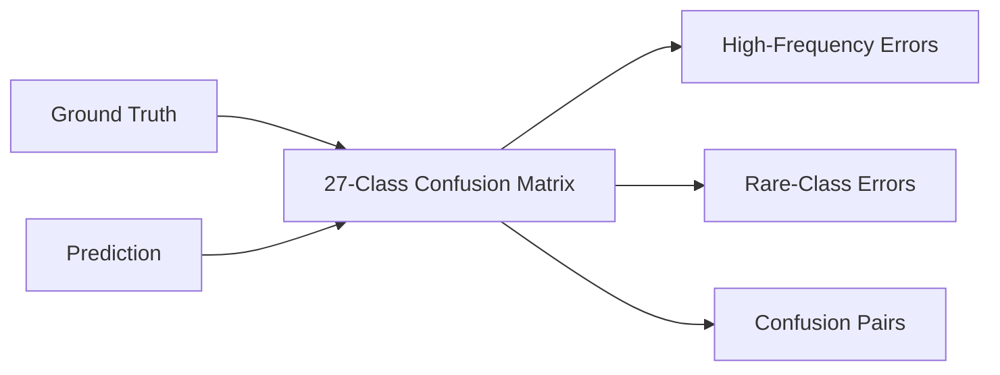

This helps identify whether failures are concentrated in known semantic boundaries.

Example:

```text
              Predicted
             Purchase  P.Order  Sales
Actual
Purchase        86       9        2
P.Order          7      82        1
Sales            2       1       91
```

The values above are purely illustrative.

---

# 20. Robust Train/Validation/Test Design

Because the challenge may use a hidden dataset, we must avoid overfitting.

Recommended evaluation split:

```text
Full labeled dataset
        ↓
Deduplication / leakage audit
        ↓
Stratified train / validation / test
        ↓
Train
        ↓
Validation → model / threshold selection
        ↓
Locked test → final internal estimate
```

For datasets with class imbalance, stratified splitting is preferred because scikit-learn specifically provides `StratifiedKFold` to preserve class representation across folds.

Where transaction groups may belong to the same business, supplier, invoice family, or temporal sequence, grouped or time-aware validation should also be considered to reduce leakage.

---

# 21. Data Leakage Controls

We will check for:

- duplicate invoice numbers;
- identical descriptions with repeated labels;
- duplicated rows;
- near-duplicate transactions;
- train/test records from the same invoice family;
- information accidentally encoded in an ID;
- hidden label leakage in filenames or column names;
- ordering artifacts;
- post-outcome fields that would not be available at prediction time.

The voucher type itself must not appear in the feature set.

This is critical because a high offline score produced through leakage would not represent genuine classification ability on an unseen evaluation dataset.

---

# 22. Baselines and Ablation Study

A scientifically useful submission should show **which components actually help**.

We will compare:

### Baseline 0 — Majority class

```text
Always predict the most frequent class.
```

Actual performance depends on the dataset distribution.

### Baseline 1 — TF-IDF + Linear Classifier

```text
Text fields
  ↓
TF-IDF
  ↓
Linear classifier
  ↓
Voucher
```

### Baseline 2 — Structured Features + Tree Model

```text
Numeric + categorical + derived accounting features
  ↓
Tree-based classifier
  ↓
Voucher
```

### Baseline 3 — Embedding Classifier

```text
BGE-M3 embeddings
  ↓
Classifier
  ↓
Voucher
```

### Model 4 — Qwen3 only

```text
Normalized transaction
  ↓
Qwen3-8B
  ↓
Voucher
```

### Model 5 — Proposed Hybrid

```text
Structured features
+
Semantic retrieval
+
Voucher knowledge
+
Qwen3 reasoning
+
confidence / validation
```

The final system is selected based on held-out performance and inference cost, not on model size alone.

---

# 23. Predicted Outcomes / Engineering Targets

**Important:** The values in this section are **projected engineering targets**, not measured results and not organizer-provided benchmarks. The actual challenge dataset, class distribution, label quality, and hidden evaluation set are not available in this README stage. These numbers must therefore be replaced with measured results after training.

| Metric | Target range | Why it matters |
|---|---:|---|
| Overall accuracy | **85–92%** | End-to-end exact voucher assignment |
| Macro-F1 | **80–88%** | Protects rare/underrepresented categories |
| Weighted-F1 | **85–93%** | Overall population performance |
| Top-2 accuracy | **93–97%** | Useful for ambiguity analysis |
| Ambiguous-subset accuracy | **70–82%** | Measures hard cases rather than easy transactions |
| JSON/schema validity | **≥99%** | Required for machine-readable downstream use |
| High-confidence precision | **90%+ target** | Makes confidence useful operationally |
| High-confidence coverage | **75–90% target** | Avoids sending every record to review |
| Review/abstention rate | **10–25% target** | Focuses human attention on genuinely difficult cases |
| Inference latency | **Optimize below 2–5 s/row** on a practical GPU setup | Supports batch processing |

### Why ranges instead of a single predicted number?

The actual dataset is not provided at qualifier stage. A single "predicted accuracy = 91.4%" would be false precision.

The proper claim is:

> **We target an 85–92% accuracy band and 80–88% macro-F1, subject to validation on the organizer-supplied dataset.**

The hidden evaluation set remains the strongest test of generalization.

---

# 24. Expected Outcome by Development Stage

## MVP

Expected working capabilities:

```text
XLSX
 ↓
Schema detection
 ↓
Normalization
 ↓
27-class Qwen3 classification
 ↓
Structured JSON
 ↓
Downloadable result
```

## Strong submission

Add:

```text
MVP
 +
semantic retrieval
 +
candidate generation
 +
confidence calibration
 +
confusion analysis
 +
explanations
 +
low-confidence review queue
```

## Stretch system

Add:

```text
Strong submission
 +
LoRA/QLoRA adaptation
 +
active learning loop
 +
error-driven prompt refinement
 +
batch inference
 +
business-level analytics
```

---

# 25. Explainability Strategy

The goal is not to expose hidden model reasoning traces.

Instead, the application returns **concise evidence-based reason codes**.

Example:

```json
{
  "voucher_type": "Contra",
  "confidence": 0.94,
  "reason_code": "internal_cash_bank_transfer",
  "evidence": [
    "cash account and bank account both present",
    "no external customer/supplier settlement",
    "transaction indicates internal transfer"
  ]
}
```

This makes the output interpretable without storing or exposing chain-of-thought.

---

# 26. Example Prediction Workflows

## Example 1 — Purchase

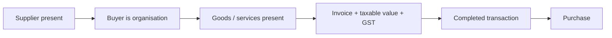

Illustrative output:

```json
{
  "invoice_number": "INV-1001",
  "voucher_type": "Purchase",
  "confidence": 0.92
}
```

---

## Example 2 — Payment


Illustrative output:

```json
{
  "invoice_number": "PAY-1002",
  "voucher_type": "Payment",
  "confidence": 0.95
}
```

---

## Example 3 — Contra

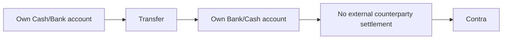

---

## Example 4 — Sales Return


---

# 27. Low-Confidence Review Queue

A practical accounting workflow should not force the model to pretend that every record is obvious.

The UI will therefore provide:

```text
┌──────────────────────────────────────────┐
│ LOW CONFIDENCE TRANSACTIONS              │
├───────────┬────────────┬─────────────────┤
│ Row       │ Prediction │ Confidence      │
├───────────┼────────────┼─────────────────┤
│ 1042      │ Purchase   │ 38%             │
│ 1057      │ Payment    │ 44%             │
│ 1091      │ Journal    │ 47%             │
└───────────┴────────────┴─────────────────┘
```

The evaluator can inspect:

- predicted voucher;
- alternative candidate;
- confidence;
- relevant input fields;
- concise evidence;
- whether a second-pass reasoner was invoked.

---

# 28. Proposed User Interface

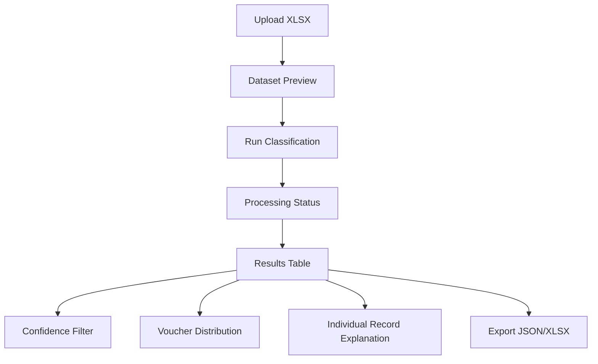

### Dashboard sections

#### Upload

- Excel drag-and-drop
- detected columns
- row count
- validation warnings

#### Prediction table

- row ID
- invoice/document number
- predicted voucher
- confidence
- alternative class
- review flag

#### Analytics

- class distribution
- confidence distribution
- low-confidence percentage
- prediction counts
- latency statistics

#### Evaluation mode

When ground truth is available:

- accuracy
- macro-F1
- weighted-F1
- precision
- recall
- per-class F1
- confusion matrix
- error examples

---

# 29. Technology Stack

## Frontend

- Next.js
- TypeScript
- Tailwind CSS
- Recharts / lightweight charting

## Backend

- Python
- FastAPI
- Pydantic
- Pandas / Polars for data processing

## AI

- **Qwen3-8B** — primary open-weight reasoning/classification model
- **BGE-M3** — semantic representation / candidate retrieval
- scikit-learn — baselines, evaluation, calibration
- PEFT / LoRA — optional model adaptation

## Inference

- vLLM
- CUDA-enabled GPU where available

## Storage

- PostgreSQL / Supabase for experiment metadata
- Local files or object storage for uploaded datasets
- Vector store only if the voucher knowledge base grows beyond a simple local index

## Development

- Git
- GitHub
- Docker
- Python virtual environment / uv / Poetry

---

# 30. Reproducibility

Every experiment will record:

```text
model name
model version / commit
prompt version
knowledge-base version
feature-engineering version
training split
validation split
random seed
decoding parameters
thresholds
evaluation results
hardware
inference time
```

A prediction should therefore be reproducible from the same:

```text
input + model + prompt + KB + configuration
```

This is especially important when evaluating hidden datasets.

---

# 31. Performance Optimization

## Fast inference path

Use non-thinking Qwen3 inference for high-confidence records.

## Candidate restriction

Instead of comparing every record against 27 classes with equal reasoning effort:

```text
27 classes
   ↓
semantic + structural candidate retrieval
   ↓
3–6 candidates
   ↓
LLM reasoning
```

## Batch processing

Use batched inference through vLLM.

## Caching

Cache:

- normalized transaction representations;
- voucher knowledge embeddings;
- repeated semantic descriptions;
- repeated supplier/product descriptions where appropriate.

## Selective reasoning

Use deeper reasoning only when:

```text
confidence < threshold
OR
top1 - top2 margin < threshold
OR
rules and LLM disagree
OR
hard confusion pair detected
```

This is intended to improve throughput without sacrificing attention on difficult cases.

---

# 32. Robustness Testing

The system will be deliberately tested against:

### Missing values

```text
GST = null
payment information = null
delivery information = null
```

### Noisy descriptions

```text
"pymnt agnst inv"
"ret goods"
"goods recd"
```

### Numeric inconsistencies

```text
taxable + GST ≠ total
```

### Ambiguous records

```text
Transaction contains both order and invoice references.
```

### Mixed currencies

```text
INR / USD / EUR
```

### Sparse records

```text
Only supplier + amount + narration
```

### Long descriptions

Ensure the model receives the information relevant to classification without uncontrolled prompt growth.

---

# 33. Error Taxonomy

Every error found during development will be assigned a cause:

```text
E1 — Missing information
E2 — Data normalization error
E3 — Incorrect event signal
E4 — Semantic confusion
E5 — Accounting-rule ambiguity
E6 — Candidate retrieval miss
E7 — LLM reasoning error
E8 — Output formatting error
E9 — Confidence miscalibration
E10 — Data leakage / evaluation artifact
```

This creates a systematic feedback loop.

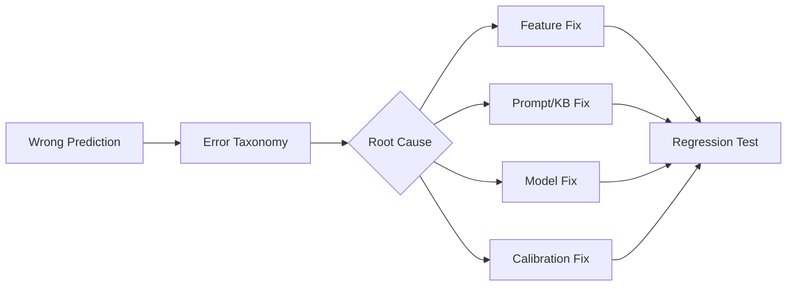

---

# 34. Testing Strategy

## Unit tests

Test:

- XLSX parsing
- schema mapping
- null handling
- amount calculations
- feature extraction
- JSON validation

## Model tests

Maintain a fixed set of regression cases:

```text
Purchase
Sales
Payment
Receipt
Contra
Purchase Return
Sales Return
Stock Journal
Purchase Order
Sales Order
...
```

Every model/prompt change must pass these before benchmark evaluation.

## Integration tests

```text
Upload XLSX
 → preprocessing
 → AI inference
 → JSON validation
 → storage
 → frontend rendering
```

## Evaluation tests

The final test script should automatically generate:

- accuracy
- precision
- recall
- macro-F1
- weighted-F1
- per-class metrics
- confusion matrix
- confidence calibration
- latency summary

---

# 35. Internal Success Criteria

The project will be considered successful when it achieves all of the following:

### Functional

- accepts organizer-supplied Excel data;
- processes multiple transaction rows;
- produces one valid voucher prediction per row;
- handles missing values;
- provides machine-readable output.

### AI

- Qwen3-8B is used as a primary intelligence layer;
- semantic retrieval provides candidate/context support;
- AI reasoning uses multiple fields;
- no proprietary API is the primary classifier.

### Reliability

- structured JSON validation;
- calibrated confidence;
- low-confidence review path;
- regression test suite;
- reproducible evaluation.

### Engineering

- modular architecture;
- documented APIs;
- containerized deployment;
- measurable inference latency;
- public GitHub repository with appropriate open-source licensing.

---

# 36. Expected Hackathon Implementation Plan

The implementation is intentionally divided into a strict MVP-first sequence.

## Phase 1 — Data pipeline

```text
XLSX ingestion
→ schema detection
→ normalization
→ canonical transaction object
```

**Deliverable:** dataset can be loaded and inspected.

## Phase 2 — Baseline

```text
TF-IDF / structured classifier
→ prediction
→ metrics
```

**Deliverable:** first benchmark.

## Phase 3 — Qwen3 integration

```text
canonical transaction
→ voucher prompt
→ structured output
```

**Deliverable:** working LLM classification.

## Phase 4 — Candidate retrieval

```text
transaction
→ BGE-M3
→ candidate voucher cards
→ Qwen3
```

**Deliverable:** hybrid classifier.

## Phase 5 — Reliability

```text
confidence
→ contradiction check
→ second-pass reasoning
→ review queue
```

**Deliverable:** robust prediction pipeline.

## Phase 6 — Dashboard

```text
upload
→ classify
→ inspect
→ filter
→ export
```

**Deliverable:** complete evaluator-facing product.

## Phase 7 — Evaluation and polish

```text
benchmark
→ confusion analysis
→ fix highest-impact errors
→ regression tests
→ final demo
```

---

# 37. Scalability

The proposed system is designed to scale from a hackathon demo to a batch accounting pipeline.

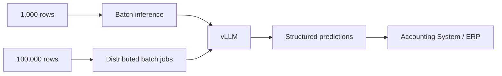

Potential production extensions include:

- asynchronous workers;
- multi-GPU inference;
- model quantization;
- prediction caching;
- human-feedback collection;
- retraining from corrected examples;
- monitoring for distribution shift;
- per-business calibration;
- API integration with accounting software.

---

# 38. Security and Data Handling

Because transaction data can contain commercially sensitive information, the default architecture favors **local/open-weight inference** instead of sending transaction data to a proprietary hosted model.

Data-handling principles:

- process data on controlled infrastructure;
- do not log complete financial records unnecessarily;
- separate identifiers from model telemetry;
- encrypt uploaded files where deployment environment supports it;
- delete temporary files after processing where appropriate;
- keep only metrics and anonymized error examples for experimentation;
- avoid exposing raw customer/supplier data in public demonstrations.

---

# 39. Known Risks and Mitigations

| Risk | Impact | Mitigation |
|---|---|---|
| Hidden dataset distribution differs from examples | High | Avoid overfitting; use stratified validation and strong baselines |
| Class imbalance | High | Macro-F1, class-wise metrics, weighted sampling where appropriate |
| Ambiguous transaction descriptions | High | Candidate retrieval + second-pass reasoning + review flag |
| LLM hallucinated class | Medium | Closed-choice structured decoding |
| Invalid JSON | Medium | Schema-constrained decoding + Pydantic validation |
| High inference latency | Medium | Non-thinking fast path + candidate reduction + batching |
| Accounting semantics misunderstood | High | Voucher knowledge base + explicit confusion pairs + domain examples |
| Data leakage | Critical | Deduplication and leakage audit |
| Overconfident predictions | High | Confidence calibration and validation |
| Fine-tuning takes too long | Medium | Ship prompt/RAG baseline first; LoRA only if justified |
| Rare labels have few examples | High | Macro-F1 + class-aware sampling + knowledge-based candidate generation |

---

# 40. Why the Proposed Architecture Is Feasible

The architecture uses components that are already available as open software/models rather than depending on proprietary API access.

### Qwen3-8B

Official sources document:

- Apache-2.0 licensing;
- 8.2B parameter size;
- thinking / non-thinking modes;
- local inference options;
- vLLM deployment support.

### BGE-M3

The model card documents:

- MIT licensing;
- multilingual support across 100+ languages;
- 1024-dimensional embeddings;
- up to 8192-token input;
- dense, sparse, and multi-vector retrieval.

### vLLM

Official documentation supports:

- JSON-schema-constrained output;
- regex;
- choice constraints;
- grammar-based constrained decoding.

### scikit-learn

Official documentation supports:

- per-class precision/recall/F1 reporting;
- macro and weighted averages;
- confusion matrices;
- probability calibration;
- stratified validation utilities.

Together these provide a realistic, reproducible technical stack for the challenge.

---

# 41. Research-Backed Design Decisions

| Decision | Evidence / rationale |
|---|---|
| Use an open-weight LLM | Direct requirement of PS4 |
| Use Qwen3-8B | Open-weight, Apache-2.0, local serving, reasoning/non-thinking modes |
| Use structured decoding | vLLM provides JSON-schema and other constrained-output modes |
| Use semantic retrieval | BGE-M3 supports multilingual semantic embeddings and retrieval |
| Use hybrid classification | Combines robust structured signals with semantic reasoning |
| Use macro-F1 | Prevents strong performance on frequent classes from hiding weak rare-class performance |
| Use confusion matrix | Reveals specific semantic class collisions |
| Calibrate confidence | Raw classifier probabilities are not necessarily calibrated |
| Validate on unseen records | Explicit requirement/expectation in challenge |
| Keep a deterministic baseline | Provides a measurable point of comparison and regression detection |

---

# 42. Limitations

The following information is **not available at qualifier stage**:

- the final training dataset;
- class frequencies;
- label noise rate;
- exact evaluation distribution;
- hidden-test size;
- organizer scoring weights;
- target hardware;
- expected maximum dataset size.

Therefore:

1. No actual accuracy claim is made.
2. The performance ranges in this README are targets, not results.
3. The final model choice may change after benchmarking the organizer dataset.
4. The system will preserve a baseline so model decisions remain evidence-driven.

This distinction is deliberate: the objective is to avoid presenting hypothetical measurements as achieved performance.

---

# 43. Predicted Final System Behavior

Under a clean structured dataset with sufficient signal, we expect the system to behave approximately as follows:

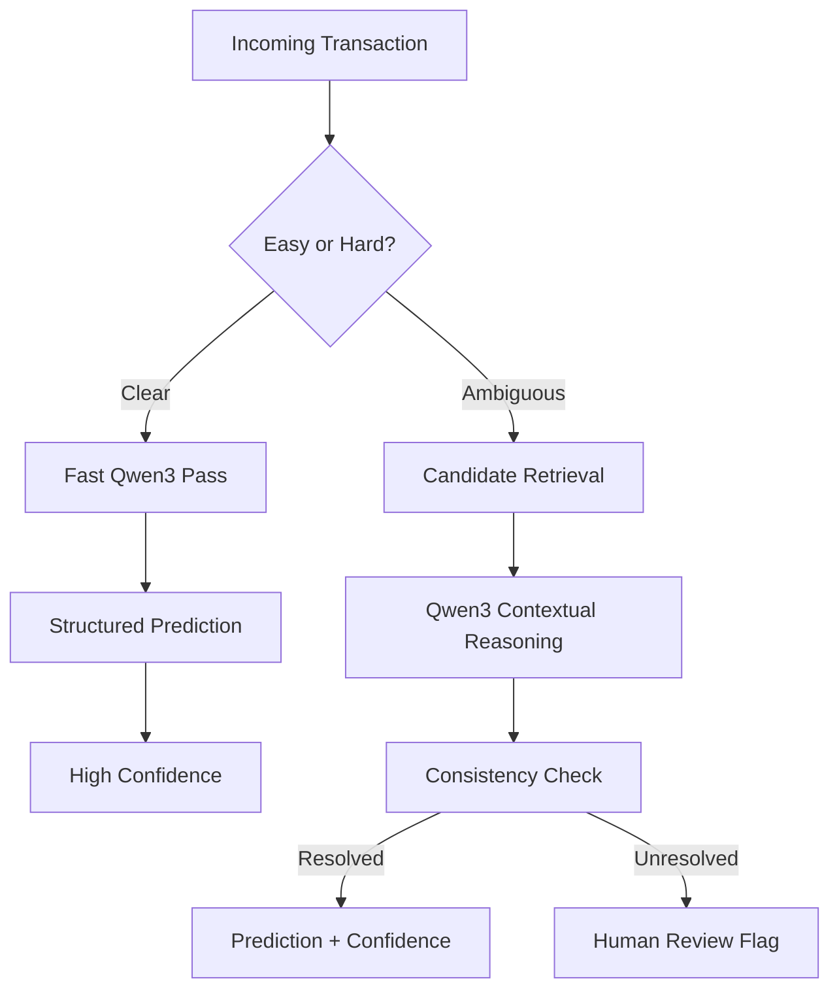

### Expected qualitative outcomes

**High confidence**
- obvious Purchase/Sales/Payment/Receipt records;
- explicit Order records;
- clear internal transfers;
- clearly identified payroll or expense events.

**Medium confidence**
- sparse records;
- records with incomplete payment/delivery information;
- transactions with both order and invoice references.

**Low confidence**
- incomplete returns;
- conflicting debit/credit semantics;
- inventory/document boundaries;
- records where several event stages are represented together.

This behavior is preferable to forcing a false sense of certainty.

---

# 44. Differentiation

The differentiating aspect is not simply:

> "We used an LLM for classification."

The proposed system instead combines:

```text
ACCOUNTING-AWARE FEATURES
          +
SEMANTIC RETRIEVAL
          +
OPEN-WEIGHT LLM REASONING
          +
HIERARCHICAL CANDIDATE SELECTION
          +
STRUCTURED OUTPUT
          +
CONFIDENCE CALIBRATION
          +
HUMAN REVIEW FOR AMBIGUITY
          +
QUANTITATIVE EVALUATION
```

The result is intended to function as a **reliable transaction-intelligence layer**, not a chatbot.

---

# 45. Minimal Final Output Contract

For every transaction:

```json
{
  "invoice_number": "INV-2026-1042",
  "voucher_type": "Purchase"
}
```

Recommended extended output:

```json
{
  "invoice_number": "INV-2026-1042",
  "voucher_type": "Purchase",
  "confidence": 0.93,
  "alternative": "Purchase Order",
  "reason_code": "completed_supplier_invoice",
  "needs_review": false
}
```

---

# 46. Final Architecture Summary

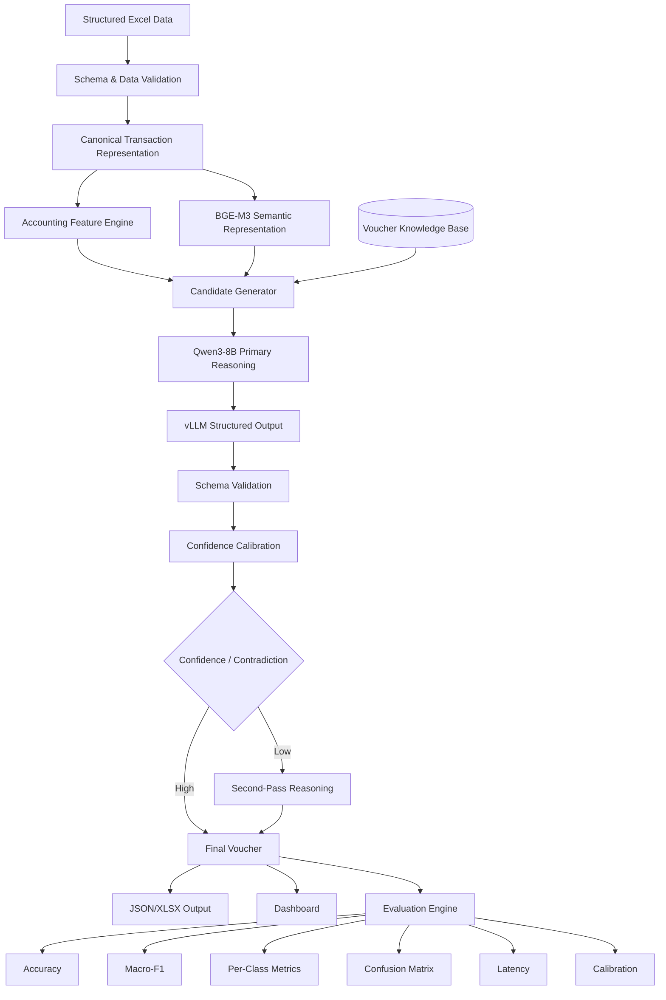

---

# 47. Expected Impact

The project aims to provide three practical outcomes:

### 1. Automated classification

Convert structured transaction records into voucher categories without manually labeling every record.

### 2. Better handling of semantic ambiguity

Move beyond keyword matching by reasoning over the complete transaction context.

### 3. Machine-readable downstream integration

Produce validated JSON/tabular outputs that can become an input to downstream accounting or ERP workflows.

The intended bridge is:

```text
Structured Transaction
        ↓
VYOM+ Intelligence
        ↓
Voucher Classification
        ↓
Validated Machine-Readable Record
        ↓
Potential Automated Voucher Creation
```

---

# 48. References and Research Sources

## Challenge source

- **Hacktober Fest — Four Final Problem Statements**, Elevate Open Source AI Hackathon, supplied by the organizers.

## Accounting / voucher workflow

- TallyHelp — **Create, Configure & Manage Voucher Types in TallyPrime**
  - https://help.tallysolutions.com/voucher-types-tally/
- TallyHelp — **Payments and Receipts**
  - https://help.tallysolutions.com/knowledgebase/payments-and-receipts-tally/

## Open-weight model

- Qwen3-8B — official Hugging Face model card
  - https://huggingface.co/Qwen/Qwen3-8B
- Qwen3 — official GitHub repository
  - https://github.com/QwenLM/Qwen3

## Semantic embeddings

- BAAI BGE-M3 — official Hugging Face model card
  - https://huggingface.co/BAAI/bge-m3

## Inference / structured outputs

- vLLM — Structured Outputs
  - https://docs.vllm.ai/en/stable/features/structured_outputs/

## Evaluation

- scikit-learn — `classification_report`
  - https://scikit-learn.org/stable/modules/generated/sklearn.metrics.classification_report.html
- scikit-learn — `confusion_matrix`
  - https://scikit-learn.org/stable/modules/generated/sklearn.metrics.confusion_matrix.html
- scikit-learn — Probability Calibration
  - https://scikit-learn.org/stable/modules/calibration.html

## Parameter-efficient fine-tuning

- Hugging Face PEFT — LoRA
  - https://huggingface.co/docs/peft/main/package_reference/lora

---

# 49. Submission Note

This repository will initially contain **README.md only**, as required for the qualifier stage.

Implementation, datasets, notebooks, binaries, and generated artifacts will be added only during the final implementation stage, in accordance with the challenge rules.

---

## One-line project statement

> **VYOM+ is an open-weight, accounting-aware AI system that reasons over complete structured transaction context to classify 27 voucher categories, producing validated machine-readable outputs with confidence and ambiguity handling.**
